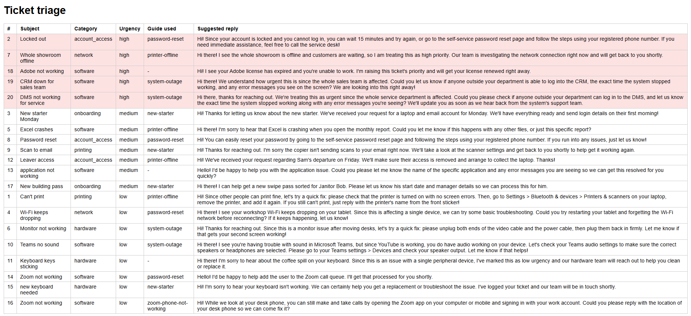

# ticket-triage

A small tool that triages IT support tickets with an AI model: it picks the best
matching how-to guide, tags each ticket with a category and urgency, drafts a reply,
and measures its own accuracy against hand-labelled answers.

I built it because I've spent three years on an IT service desk, and wanted to see
how much of the first-pass triage an AI could do reliably.



## How it works

1. Tickets are loaded from a CSV into SQLite (`db.py`).
2. Each ticket is matched to the closest knowledge-base guide by shared keywords (`kb.py`).
3. The ticket and guide go to an LLM (Gemini), which returns JSON: category, urgency, reply (`llm.py`).
4. The answer is validated against the allowed values before it's saved (`parse_response`).
5. `evaluate.py` compares the results with my own labels.
6. `app.py` shows the results, most urgent first.

All tickets and guides are made up. No real company data is used.

## Results

| Version | Tickets | Category accuracy | Urgency accuracy |
| --- | --- | --- | --- |
| First run | 18 | 67% (12/18) | 50% (9/18) |
| After adding guides and urgency rules | 20 | 70% (14/20) | 60% (12/20) |

The second run also includes two new tickets, so it isn't a strict like-for-like comparison.

## What I learned

I labelled "keyboard not working" as low urgency, because in my experience on the
service desk users often say they can't work before trying anything, and it's usually
a flat battery, an unplugged dongle or a device that isn't switched on. The AI marked
it high, because my prompt said "someone cannot work at all" means high urgency.
Taking the ticket literally, that's fair. It only follows the rules I write, so my own
judgement had to go into the prompt: I added rules that a workaround, or a single
device that probably needs basic troubleshooting, means low urgency even if the user
says they can't work.

Some tickets needed knowledge the AI didn't have. It couldn't know our users can take
calls in the Zoom app when their desk phone fails, so I added a guide that says so.
I also found the keyword matching attached the wrong guide on shared words like
"working": an Adobe licence ticket picked up the Zoom phone guide, whose workaround
could have pushed it to low urgency. Removing those filler words fixed it.

With these changes urgency went from 50% to 60%, but I changed several things at once,
so I can't tell which helped most. Next time I'd change one thing per run, and replace
keyword matching with embeddings so guides are matched by meaning, not by coincidental words.

## Run it yourself

```bash
pip install -r requirements.txt
export GEMINI_API_KEY=...   # free key from aistudio.google.com, or put it in a .env file
python triage.py
python evaluate.py
python app.py
```

Tests: `pytest` (they also run on every push via GitHub Actions).